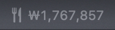
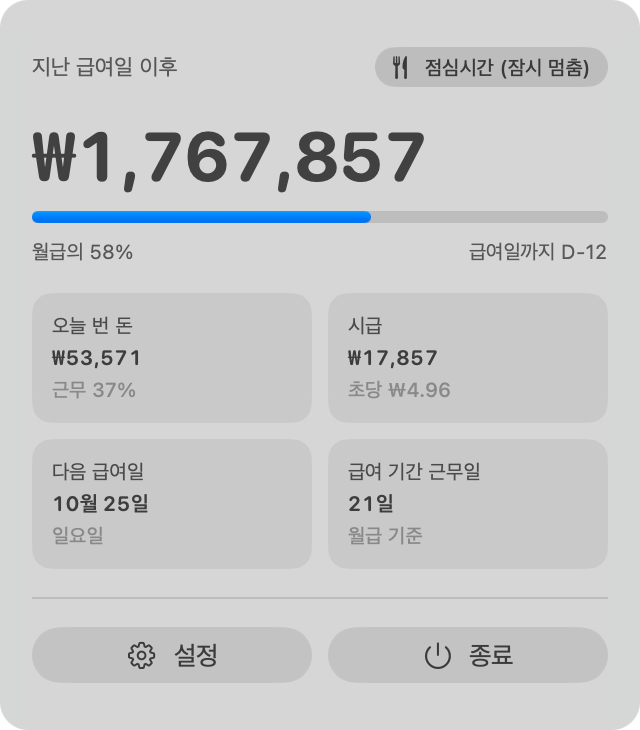
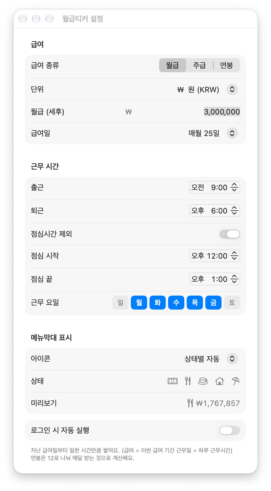

# 월급티커 (SalaryTicker)

Mac 메뉴막대에서 **지난 급여일부터 지금까지 번 돈**이 1초마다 올라가는 걸 보여주는 작은 앱이에요.

<p align="center"></p>

<table align="center">
<tr>
<td></td>
<td></td>
</tr>
<tr><td align="center">메뉴막대를 클릭하면</td><td align="center">설정 창</td></tr>
</table>

## 기능

- 월급 · 주급 · 연봉 중 골라서 입력 (연봉은 12로 나눠 매달 받는 것으로 계산)
- 급여일 설정: 매월 N일 / 말일, 주급은 매주 요일
- 출퇴근 시간, 점심시간 제외, 근무 요일 설정
- 금액 단위: ₩ $ € ¥ 元 £ 등 (환전 없이 표시 단위만 바뀌어요)
- 메뉴막대 아이콘: 상태별 자동(근무 중 · 점심 · 출근 전 · 퇴근 · 휴일마다 바뀜) / 10가지 중 직접 고르기 / 없음
- 클릭하면 오늘 번 돈, 시급, 초당 금액, 급여일까지 D-day
- 로그인 시 자동 실행
- 가벼움: 평소 메모리 20~30MB, CPU 1% 미만

계산 방식: `급여 ÷ 이번 급여 기간의 근무일 수 ÷ 하루 실근무 시간`. 공휴일은 따로 빼지 않아요.

## 설치

1. [Releases](../../releases/latest)에서 `SalaryTicker.zip`을 받아 압축을 풀어요.
2. `월급티커.app`을 **응용 프로그램** 폴더로 옮겨요.
3. 열면 메뉴막대에 금액이 나타나요. 처음 실행하면 설정 창이 떠요.

Apple 공증을 받은 앱이라 경고 없이 바로 열려요.

macOS 14 (Sonoma) 이상, Apple Silicon · Intel 모두 지원해요.

## 직접 빌드

Xcode 명령줄 도구만 있으면 돼요.

```bash
git clone https://github.com/Younkyum/SalaryTicker.git
cd SalaryTicker
./build.sh          # build/월급티커.app
./build.sh zip      # build/SalaryTicker.zip
```

## 라이선스

MIT
